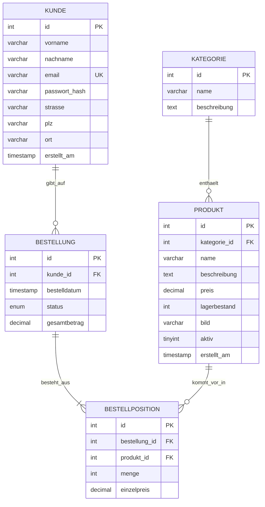

# Datenbankmodell

| Tabelle           | Zweck                                                        |
|-------------------|--------------------------------------------------------------|
| `kategorie`       | Produktkategorien                                            |
| `produkt`         | Artikel mit Preis, Lagerbestand und Bild                     |
| `kunde`           | Registrierte Kunden (Passwort nur als Hash)                  |
| `bestellung`      | Bestellkopf: Kunde, Datum, Status, Total                     |
| `bestellposition` | Artikel einer Bestellung inkl. Preis zum Bestellzeitpunkt    |
